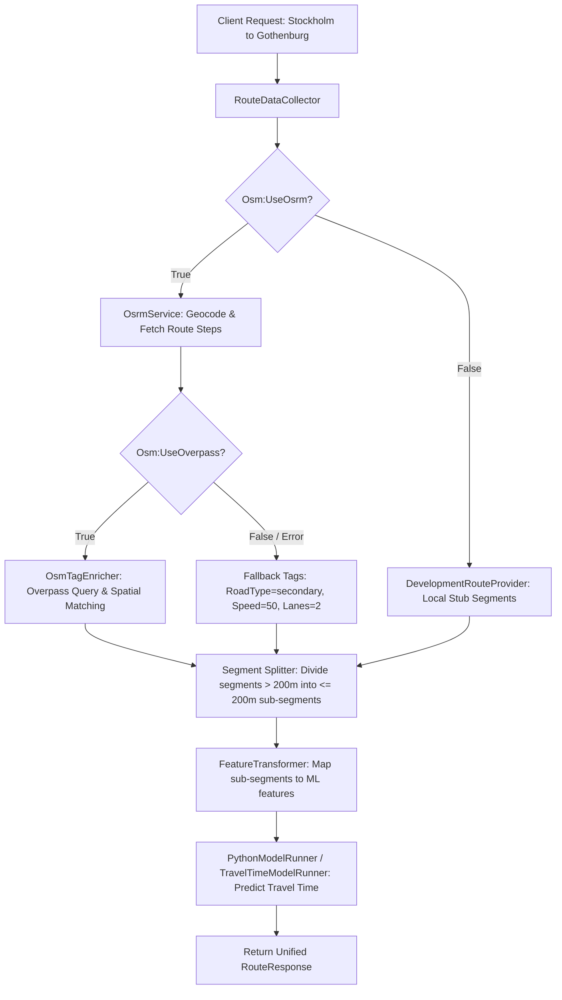

# Architectural Specification & Plan: Overpass Toggle, Robust Fault-Tolerance, and Sub-200m Segment Splitting

## 1. Context & Objectives

The goal is to enhance the travel time estimation pipeline in [`TimeEstimationAPI/Program.cs`](TimeEstimationAPI/Program.cs:1):
1. **Fix 500 Internal Server Errors** caused by Overpass API downtime/timeouts (`https://overpass-api.de/api/interpreter`).
2. **Implement Feature Toggles** for Overpass enrichment (`Osm:UseOverpass`) alongside the existing `-UseOsrm` routing switch.
3. **Preserve Existing Code Base**: Clean up C# 12 primary constructor redundancy in [`TimeEstimationAPI/Services/OsmTagEnricher.cs`](TimeEstimationAPI/Services/OsmTagEnricher.cs:10) without destroying spatial geometry algorithms (`MaxQuerySpanDegrees`, `MaxMatchDistanceDegrees`, bounding box intersection, tag parsing). If you feel MaxQuerySpanDegress etc are unneeded, then feel free to change/remove, but give a reason for it tho. 
4. **Implement Sub-200m Segment Splitting**: Long OSRM route steps (e.g., motorway legs between Aalborg and Odense or Stockholm and Gothenburg) must be divided into smaller sub-segments ($\le 200\text{ m}$) before being passed to feature transformation and the ML model.
5. **Normalize Test Collections**: Standardize HTTP test requests in [`TimeEstimationAPI/TimeEstimationAPI.http`](TimeEstimationAPI/TimeEstimationAPI.http:1) across 67m, 42m, and 150m test segments.

---

## 2. Clarifying Answers to User Questions

### Q1: Dual `logger` / `_logger`, `httpClient` / `_httpClient`, and `configuration` / `_configuration`
In C# 12, classes using primary constructor syntax (e.g. `public sealed class OsmTagEnricher(HttpClient httpClient, IOptions<OsmOptions> options, ILogger<OsmTagEnricher> logger)`) make primary parameters available throughout the instance body.
If separate `private readonly` fields are declared with leading underscores alongside primary parameters, or if `IConfiguration` is injected redundantly alongside `IOptions<OsmOptions>`, it creates duplicate field bindings.
**Solution**: We will bind configuration options cleanly via `IOptions<OsmOptions>` and access primary constructor parameters directly without duplicate `_logger` / `_httpClient` fields.

### Q2: Preservation of `OsmTagEnricher.cs` Structure
The instructions from Gemini web chat proposed wiping and rewriting `OsmTagEnricher.cs`, which would have stripped constants (`MaxQuerySpanDegrees = 0.22`, `MaxMatchDistanceDegrees = 0.0001`), spatial distance algorithms (`AverageDistanceSquaredToWay`, `MaximumDistanceSquaredToWay`), bounding box generation, and records (`OsmWay`, `BoundingBox`).
**Solution**: We will preserve 100% of the spatial matching math, bounding box loops, tag mapping, and records in [`TimeEstimationAPI/Services/OsmTagEnricher.cs`](TimeEstimationAPI/Services/OsmTagEnricher.cs:1). We will only wrap network calls in `try-catch`, check `_options.UseOverpass`, and apply graceful fallbacks.

### Q3: Difference between `-UseOsrm` and `-UseOverpass`
- **`-UseOsrm`**: Controls the **Route Provider** (`OsrmService` vs `DevelopmentRouteProvider`). When enabled, the API calls live OSRM geocoding and routing servers (`https://router.project-osrm.org`) to fetch route geometry and turn-by-turn steps.
- **`-UseOverpass`**: Controls the **Tag Enricher** (`OsmTagEnricher`). When enabled, the API queries the Overpass API (`https://overpass-api.de/api/interpreter`) to retrieve OpenStreetMap road metadata (`highway`, `maxspeed`, `lanes`, `bridge`, `tunnel`) for OSRM segments. When disabled, Overpass network calls are skipped completely, preventing 500 errors and long delays.

---

## 3. Sub-200m Segment Splitting Workflow Architecture



---

## 4. Detailed Implementation Steps

### 1. Script & Environment Configuration ([`Start-LocalServices.ps1`](Start-LocalServices.ps1:1))
- Add `[switch]$UseOverpass` parameter to `param()`.
- Set `$env:Osm__UseOverpass = if ($UseOverpass) { "true" } else { "false" }`.
- Print status in startup log output.

### 2. Application Settings ([`TimeEstimationAPI/appsettings.json`](TimeEstimationAPI/appsettings.json:15))
- Ensure `Osm` section contains:
  ```json
  "Osm": {
    "UseOsrm": false,
    "UseOverpass": false,
    "GeocodingUrl": "https://nominatim.openstreetmap.org/search",
    "RoutingUrl": "https://router.project-osrm.org/route/v1/driving",
    "OverpassUrl": "https://overpass-api.de/api/interpreter"
  }
  ```

### 3. Service Registration & HTTP Timeout ([`TimeEstimationAPI/Program.cs`](TimeEstimationAPI/Program.cs:29))
- Configure `OsmTagEnricher` HTTP client with strict 10-second timeout:
  ```csharp
  builder.Services.AddHttpClient<OsmTagEnricher>(client =>
  {
      var url = builder.Configuration["Osm:OverpassUrl"] 
          ?? "https://overpass-api.de/api/interpreter";
      client.BaseAddress = new Uri(url);
      client.Timeout = TimeSpan.FromSeconds(10);
  });
  ```

### 4. Robust Tag Enrichment ([`TimeEstimationAPI/Services/OsmTagEnricher.cs`](TimeEstimationAPI/Services/OsmTagEnricher.cs:10))
- Check `_options.UseOverpass`: if `false`, return `ApplyFallbackTags(segments)`.
- In `FetchWaysAsync`, catch `HttpRequestException`, `TaskCanceledException`, `OperationCanceledException`, and `JsonException`, logging warnings and returning null.
- If no ways are returned, execute `ApplyFallbackTags(segments)`.
- Fallback default values: `RoadType = "secondary"`, `SpeedLimitKmh = 50`, `LaneCount = 2`.
- Retain all `MaxQuerySpanDegrees`, `MaxMatchDistanceDegrees`, `CreateBoundingBoxes`, `AverageDistanceSquaredToWay`, `MaximumDistanceSquaredToWay`, `ParseWay`, and record types.

### 5. Sub-200m Segment Splitting Logic ([`TimeEstimationAPI/Services/RouteDataCollector.cs`](TimeEstimationAPI/Services/RouteDataCollector.cs:1))
- Implement segment splitting in `RouteDataCollector` (or dedicated helper method) after enrichment:
  - Max segment length threshold: $200\text{ meters}$.
  - For each segment exceeding $200\text{ m}$, divide into $N = \lceil \text{Length} / 200.0 \rceil$ sub-segments.
  - Divide `LengthMeters` and `ProviderSegmentTimeSeconds` proportionally ($L / N$).
  - Preserve road type, speed limit, lane count, bridge, tunnel, and OSM way IDs across sub-segments.
  - Interpolate/partition `Geometry` coordinates along sub-segments.

### 6. HTTP Endpoint Tests ([`TimeEstimationAPI/TimeEstimationAPI.http`](TimeEstimationAPI/TimeEstimationAPI.http:1))
- Align test requests across `pythonBaseUrl` (`http://127.0.0.1:8001`) and `apiBaseUrl` (`http://localhost:5073`).
- Normalize segment lengths to 67m (residential, 50km/h), 42m (motorway, 110km/h, bridge), and 150m (primary, 80km/h, roundabout).
